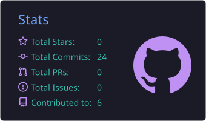
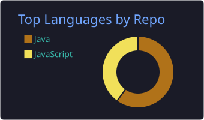

<h1 align="center">Hi 👋, I'm Dinesh</h1>

<h3 align="center">Java Full Stack Developer | Backend Developer | Spring Boot | React.js</h3>

  

  <a href="https://www.linkedin.com/in/dinesh-k-63a292324">LinkedIn</a> •
  <a href="https://java-fullstack-portfolio-two.vercel.app">Portfolio</a> •
  <a href="mailto:dineshkumar86106@gmail.com">Email</a>

---

<table>
<tr>
<td valign="top" width="50%">

### 👨‍💻 About Me

* 🎓 MCA graduate and Java Full Stack Developer (fresher), based in Chennai.
* ☕ Backend: Java, Spring Boot, Spring Security, JWT.
* ⚛️ Frontend: React.js.
* 🗄️ Database: MySQL, Spring Data JPA, Hibernate.
* 🏦 Built a Banking Application with 25+ REST APIs.
* 🏛️ Built the CSES Portal frontend with React.js.
* 🛒 Currently building an E-commerce Web Application.
* 📚 Learning DSA, Docker, and Microservices basics.
* 🎯 Open to Java Developer, Backend, Full Stack, and Software Engineer roles.

</td>
<td valign="top" width="50%">

### 💼 Experience

**Full Stack Developer Intern** | VCodez, Chennai
📅 Feb 2025 – May 2025

### 🎓 Education

**MCA** | Gnanamani College of Technology
📅 2023 – 2025 | 📊 CGPA: 7.7

**B.Sc. Computer Science** | Government Arts and Science College
📅 2020 – 2023 | 📊 68%

### 📚 Training

**Java Full Stack Development** | QSpiders, Vadapalani, Chennai
📅 Nov 2025 – Sep 2026
Core Java, Spring Boot, Hibernate, SQL, HTML5, CSS3, JavaScript, React.js

</td>
</tr>
</table>

---

## 🛠️ Technical Skills

  

| Category    | Technologies                                                                 |
| ----------- | ---------------------------------------------------------------------------- |
| Languages   | Java, SQL, JavaScript                                                        |
| Backend     | Spring Boot, Spring MVC, Spring Security, Spring Data JPA, Hibernate, JWT, REST APIs |
| Frontend    | React.js, React Router, Hooks, Context API, Axios, HTML5, CSS3, Tailwind CSS |
| Database    | MySQL                                                                        |
| Tools & Testing | Git, GitHub, Maven, Postman, JUnit, Mockito, Docker (Basics)             |
| Concepts    | DSA, OOP, Collections, Java 8 Features, DTO Pattern, Pagination, Microservices (Basics) |

---

## 🚀 Featured Projects

<table>
<tr>
<td valign="top" width="33%">

### 🏦 [Banking Application](https://github.com/Dinesh-now/Banking-Application-Full-Stack)

Full stack banking app.

* 25+ REST APIs: User, Account, Transaction, Loan.
* JWT authentication with Spring Security.
* Deposit, withdraw, transfer with validation.
* Paginated transaction history.
* Loan workflow: Applied, Approved, Disbursed, Repaid.

**Stack:** Java, Spring Boot, Spring Security, JWT, JPA, Hibernate, MySQL, React.js, Axios

</td>
<td valign="top" width="33%">

### 🏛️ [CSES Portal](https://github.com/Dinesh-now/cses_portal)

Frontend case management portal.

* Admin login, protected routes, logout.
* Dashboard with summary cards.
* CRUD for Cases, Parents, Children, Payments, Court Orders.
* Parent with a child cannot be deleted.
* Reports module, data saved in localStorage.

**Stack:** React.js, React Router DOM, Context API, Hooks, localStorage, sessionStorage, CSS

</td>
<td valign="top" width="33%">

### 🛒 [E-commerce App](https://github.com/Dinesh-now/E-CommereceApp) *(In Progress)*

Full stack online shopping app.

* Product add, edit, delete.
* Product search and filtering.
* User login and add-to-cart.
* Order placement and history.
* React frontend connected via REST APIs.

**Stack:** Java, Spring Boot, React.js, MySQL, JPA, Hibernate

</td>
</tr>
</table>

---

## 📊 GitHub Statistics

  
  

---

  💼 <a href="https://www.linkedin.com/in/dinesh-k-63a292324">LinkedIn</a> •
  🌐 <a href="https://java-fullstack-portfolio-two.vercel.app">Portfolio</a> •
  📧 <a href="mailto:dineshkumar86106@gmail.com">dineshkumar86106@gmail.com</a>

  <b>Building. Learning. Improving. 🚀</b>

